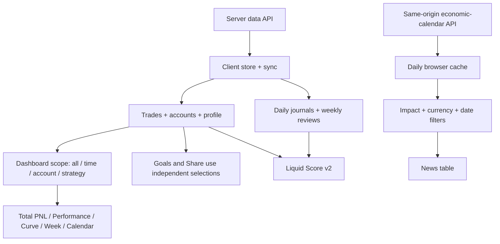
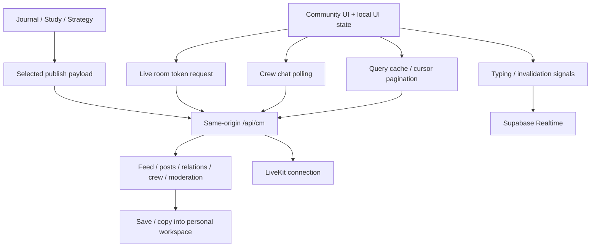
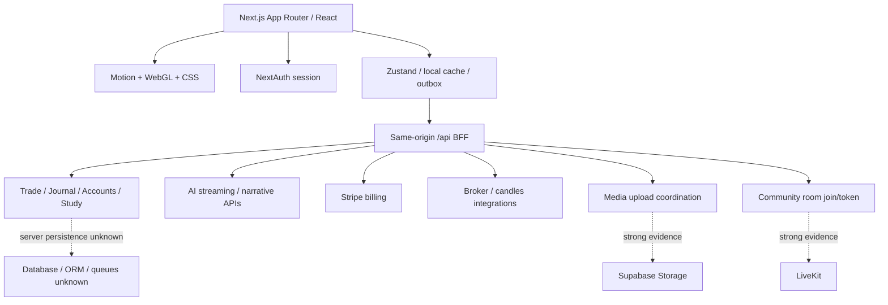

# LiquidJournal — Feature-by-feature engineering study

Public-safe edition: ตัดชื่อ บัญชี เนื้อหาเทรด และตัวเลขผลประกอบการส่วนบุคคลออก เก็บสูตรและข้อสังเกตทางวิศวกรรมเท่านั้น

วันที่ตรวจ: 29 ตุลาคม 2026 (Asia/Bangkok) · เอกสารทำงานสำหรับออกแบบผลิตภัณฑ์ของตนเอง

## วิธีอ่านและลำดับการศึกษา

รายงานเรียงจากข้อมูลต้นทาง → การคำนวณ → UI → ข้อจำกัด → แนวทางนำไปสร้าง เพื่อให้ตรวจย้อนกลับได้ ทุกข้อแยกสิ่งที่สังเกตจริง, implementation ที่พบใน shipped JavaScript และข้อเสนอของเรา ไม่อ้างว่าได้เห็น source server

| บท | ฟีเจอร์ | ระดับการตรวจ |
|---|---|---|
| 1 | Dashboard: ทั้ง 9 ส่วนที่ขอ | เจาะ UI และสูตรใน client code รอบนี้ |
| 2 | Landing / Intro / Login | หลักฐานจากรอบก่อน |
| 3 | Journal | ภาพรวมเดิม; ยังไม่ทำ feature deep dive |
| 4 | Analytics / AI | ข้อสังเกตเดิม; รอรอบเจาะเฉพาะ |
| 5 | Prop firm | ภาพรวมกฎและบัญชีจากรอบก่อน |
| 6 | Study / Strategy | ภาพรวมเดิม; ยังไม่ทำ feature deep dive |
| 7 | Community | UI + static deep dive จากรอบก่อน |
| ภาคผนวก | Stack, architecture, evidence | เก็บหลักฐาน M/B/C และ D แยกจากข้อเสนอ |

งานรอบนี้ตรวจเฉพาะ Dashboard และ popup ของ Dashboard ไม่ขยายไปฟีเจอร์อื่น ไม่แก้ goals/settings, ไม่บันทึก trade, ไม่ share/download ภาพจริง, ไม่ใช้เครดิต AI มีการเปิด preview และยกเลิกเท่านั้น REA MCP ยังไม่เชื่อมต่อ จึงใช้ browser UI และ static assets สาธารณะที่โหลดใน session เดิม ไม่มี REA Evidence ID

**เรื่องการสร้างด้วย AI:** การวาง stack หรือหน้าตาไม่ใช่หลักฐานยืนยันผู้เขียนหรือกระบวนการสร้าง สิ่งที่เรานำมาใช้ได้คือพฤติกรรมที่ตรวจได้และหลักการออกแบบ ไม่จำเป็นต้องตั้งสมมติฐานว่าใครเขียนโค้ด

## บทที่ 1 — Dashboard

### ขั้นที่ 1: กำหนดแหล่งข้อมูลก่อนคัดลอกกราฟ

กราฟและตัวเลขหลายจุดคำนวณใน browser จากข้อมูล store ไม่ได้มี backend endpoint แยกต่อกราฟ การกรองข้อมูลก่อนคำนวณจึงเป็นหัวใจ ถ้าจะสร้างของตนเองต้องกำหนด closed trade, net P&L, 1R, breakeven, trading day, week start, timezone และ cashflow ให้ชัดก่อน UI

**ข้อค้นพบที่ส่งผลต่อการเลียนแบบ:** hero scope ไม่ได้ควบคุมทุก widget เหมือนกัน Goals และ Share profile มี selection ของตนเอง; payout ไม่ใช่ trading P&L; score ไม่ใช่เปอร์เซ็นต์ win rate โดยตรง ส่วนข่าวไม่ได้พิสูจน์ว่า realtime

### ขั้นที่ 2: Total P&L ตรงกลาง

**ข้อมูลต้นทาง:** `useTrades()` จาก client store ผ่าน real/paper mode ก่อน แล้วใช้ hero scope เลือก All time, Last 30 days, This week, account/group หรือ strategy; scope ของหลายบัญชีอาจ remap P&L ตาม allocation ของบัญชีที่เลือก ไม่ใช่ใช้ยอดทั้งเทรดเสมอ

**สูตร:** ตัด `noTradeDay` ออก แล้ว `totalPnl = Σ trade.pnl` ไม่หัก commission ซ้ำที่ selector นี้ ดังนั้นผู้สร้างต้องกำหนดว่า `pnl` ที่บันทึกเป็น net แล้วหรือไม่ ปุ่ม Realized (payouts) เปลี่ยนเลข hero เป็นผลรวม payout ของ funded accounts ซึ่งเป็น cashflow คนละอย่างกับ trading P&L และไม่ได้เปลี่ยนกราฟอื่นให้เป็นกราฟ payout โดยอัตโนมัติ [D-M1–2]

**UI:** CountingMoney, สี/glow ตามผลลัพธ์, แสดง W/L, ปุ่มเลือก scope และดาวบันทึก default เปิด Dashboard ค่าการแสดงผลปัดเงินเป็นดอลลาร์เต็มในหลายตำแหน่ง จึงเห็น $13.50 เป็น +$14

**ถ้าสร้างของเรา:** แยกชื่อ Net trading P&L, Payouts และ Return on capital ให้ชัด และทำ Scope label ต่อ widget การเปลี่ยน filter ต้องไม่ทำให้ผู้ใช้คิดว่าทุกส่วนของหน้าถูกกรองเหมือนกัน

### ขั้นที่ 3: ปุ่ม Share profile

**พฤติกรรมที่ตรวจ:** เปิด preview มี Month / Year / All พร้อม P&L, trade count, W/L, win rate, Avg Win RR, avg win/loss, symbol ที่ใช้มากและข้อมูล firm/accounts จากนั้นปิดโดยไม่แชร์ [D-M8]

**implementation:** โหลด `FlexShareWindow` แยกแบบ dynamic → ดึง `useTrades()` ของตนเอง → กรองช่วงเวลา → `calcStats` → วาด card และ sparkline SVG → render PNG ใน browser จาก card ขนาด 420×760 ที่ pixelRatio 2.6 ได้ขนาดประมาณ 1092×1976 → ใช้ `navigator.share` หากรองรับไฟล์ ไม่เช่นนั้น download

ไม่มีหลักฐานว่าเส้นทางปุ่มนี้สร้าง public profile URL หรือโพสต์ Community โดยอัตโนมัติ กราฟย่อยใน card เริ่มจาก 0 และคำนวณสะสมเอง ต่างจาก Recharts ของ Dashboard

**ข้อควรระวัง:** ไม่รับ hero filter; เดือน/ปีใช้ UTC prefix จาก `toISOString()`; symbol dominance วัดจำนวนเทรด ไม่ใช่มูลค่าหรือกำไร; firm/account count ไม่จำกัดเฉพาะบัญชีที่มีเทรดในช่วงนั้น และโมดูล export ไม่ได้อ่าน `hidePnl` ของ Dashboard จึงไม่ควรคาดว่าซ่อนเงินในหน้าหลักแล้วภาพแชร์จะซ่อนด้วย

**ถ้าสร้างของเรา:** มี privacy preview ก่อน export และให้เลือกข้อมูลที่จะเปิดเผย รวมทั้งระบุช่วงเวลา, scope, timezone และสถานะ Manual/Imported/Broker-synced ของข้อมูล

### ขั้นที่ 4: การ์ด Performance

ให้ `B` เป็น breakeven money band ที่ผู้ใช้ตั้ง; default อาจเป็น 0 แต่ต้องอ่าน settings จริง

| ตัวแปร | สูตรจาก client |
|---|---|
| เทรดจริงสำหรับสถิติ | records ที่ไม่ใช่ `noTradeDay` |
| Winner / loser | `pnl > B` / `pnl < -B` |
| Win rate | `wins / (wins + losses) × 100`; breakeven ไม่อยู่ในตัวหาร |
| Profit Factor | `grossProfit / abs(grossLoss)`; ไม่มี loss แต่มี profit เป็น Infinity |
| Avg Win | gross profit ของ winners / จำนวน winners |
| Avg Loss | absolute gross loss / จำนวน losers |
| Avg Win RR | เฉลี่ย `rr` เฉพาะเทรดชนะที่มีค่า R |
| Avg R ใน Score | เฉลี่ย `rr` ของทุกเทรดจริงที่มีค่า R |

วงกลม Win Rate แสดง raw percentage โดยตรง ส่วน Liquid Score แปลงเป็นอีกสเกลหนึ่ง ห้ามใช้ฟังก์ชันเดียวกันวาดทั้งสองโดยไม่แยกความหมาย

**“Not enough history yet” หมายถึงอะไร:** ไม่มีข้อมูลพอเปรียบเทียบการเปลี่ยนแปลงระหว่างช่วง ไม่ใช่คำนวณค่าปัจจุบันไม่ได้ โค้ดเปรียบเทียบ 30 วันล่าสุดกับ 30 วันก่อนหน้า และอาจ fallback ไปประวัติก่อนหน้านั้น Win rate ต้องมีอย่างน้อย 5 decisive trades ทั้งสองช่วง; Avg Win RR ต้องมีอย่างน้อย 3 winners ที่มี R และค่าเฉลี่ยเป็นบวก; Avg Win ต้องมีอย่างน้อย 3 wins และค่าเฉลี่ยเป็นบวก เปอร์เซ็นต์ delta ของการ์ดคือ relative change ไม่ใช่ percentage points และไม่ใช่การทดสอบ statistical significance

### ขั้นที่ 5: Cumulative P&L

**ลำดับ:** selected trades → ตัด no-trade records → group ตาม `trade.date` → sum รายวัน → sort วัน → running sum → plot [D-M4]

กราฟใช้ Recharts AreaChart/Area แบบ monotone, เส้น 2px, gradient fill และแกนเงิน เป็น **เส้นสะสมกำไรขาดทุน** ไม่มี opening capital จึงไม่ใช่ equity balance ของบัญชี ไม่เติมวันที่ไม่มีเทรด และเริ่มที่วันเทรดแรก ไม่ได้เพิ่มจุด 0 นำหน้าเหมือนภาพ Share profile

มี ResizeObserver, double requestAnimationFrame ก่อนวาด, animation ประมาณ 1100ms ease-out และจุดปลายเรืองแสง สีทั้งเส้นขึ้นกับผลรวมปลายช่วง ไม่ได้เปลี่ยนสีทุกจุดตามว่าแต่ละวันกำไรหรือขาดทุน ซ่อน tooltip เมื่อ hidePnl

**ข้อควรแก้หากเลียนแบบ:** ข้อมูล plot ปัด `Math.round(cumulative)` ทำให้เซนต์หายจากจุดกราฟ; label “All time” hardcoded แม้ hero scope กรองข้อมูล; display date แบบ “MMM d” ไม่ควรใช้เป็น identity ข้ามปี ของเราควรเก็บ full ISO date และ raw cents เสมอ แล้วปัดเฉพาะ label

### ขั้นที่ 6: This Week

**สูตร:** ใช้เทรดตาม hero scope, เริ่มสัปดาห์วันจันทร์ตาม browser time แล้ว sum P&L, นับเทรด, คำนวณ wins/(wins+losses) ส่วน last week มีขอบเขตจันทร์–อาทิตย์ชัดเจน [D-M5]

**ข้อจำกัด:** ยอดรวมอาจรวม weekend แต่แท่งมีเพียง 5 วัน เหมาะกับภาพตลาด weekdays แต่จะชวนสับสนถ้าใช้กับ crypto; current-week selector ไม่มี upper bound วันนี้ในโค้ด แม้ label บอก “to today” ต้องกัน future-dated records ในผลิตภัณฑ์ของเรา

### ขั้นที่ 7: Liquid Score — สูตรจริงของเวอร์ชันที่ตรวจ

**ยืนยันรุ่นก่อน:** bundle มี legacy และ `score-v2`; หน้าปัจจุบันมีสวิตช์ 30 days/All time จึงเป็น v2 สูตรด้านล่างเป็น deterministic arithmetic ไม่ใช่ AI คะแนนข้อความ “Score & Psychology” เป็นอีกส่วนหนึ่ง [D-S1–9]

**แหล่งข้อมูล:** `useTrades()`, `useJournals()`, `useWeeklyReflections()` หลัง mode filtering จาก client store ไม่ได้เรียก AI ทุกครั้งที่วาด radar

**ขอบเขต:** v2 ใช้สวิตช์เวลาของ Score เอง ไม่ตาม hero All/Week/30d; รับ strategy/account scope ใน performance spokes แต่ Discipline ใช้ชุด journal/trades รวมของ mode นั้น ช่วง 30 วันรวมวัน asOf ย้อน 29 วัน ตัดอนาคต และหากมีเทรดจริงน้อยกว่า 10 จะ fallback all-time นี่เป็นกฎเลือกข้อมูล ไม่ใช่หลักฐานว่าครบ 10 แล้วสถิติน่าเชื่อถือ

กำหนด `C(x)=clamp(round(x),0,100)` แต่ละแกนปัดก่อนนำไปเฉลี่ย

**7.1 Win Rate score — คำนึงถึง payoff**

ให้ `p=wins/(wins+losses)`; `A=avgWin/avgLoss`; `b=1/(1+A)` คือ win rate คุ้มทุนจาก payoff ที่เกิดขึ้นจริง

- เมื่อ `p≤b`: `C(40p/b)`
- เมื่อ `b<p<1`: `C(40 + 60√((p-b)/(1-b)))`
- เมื่อ `p=1`:100
- กรณี b≤0: `C(40 +60√p)`; ไม่มี payoff ให้เทียบใช้ `C(100p)` ตาม branch ในโค้ด

**7.2 Profit Factor score**

`PF≤1 → C(40PF)`; `PF>1 → C(40+60(PF−1))`; Infinity→100 ดังนั้น PF1=40, PF2 ขึ้นไป=100 และ PF1.7231→**83** เป็นสเกลกำหนดเอง ไม่ใช่ percentile เทียบกับผู้ใช้คนอื่น

**7.3 Avg R score**

`avgR≥0 → C(40+150avgR)`; `avgR<0 → C(40+100avgR)` โดย avgR เป็น R เฉลี่ยของทุกเทรดที่มี R ไม่ใช่ Avg Win RR1.91 ที่เห็นในการ์ด ตัวอย่าง avgR≈+0.30 ได้ **85**; +0.4R ได้100 ค่า R ที่ขาดถูกตัดออก ไม่ใช่แทนด้วย0

**7.4 Consistency score**

ต้องมีอย่างน้อย3วันเทรด ไม่ครบถือว่าแกนไม่มีข้อมูล

- net profit≤0: `C(greenDays/tradedDays ×100)`
- net profit>0: ให้ `s=bestDailyPnl/netProfit`; s≤0.30 ได้100; ไม่เช่นนั้น `C((1−s)/0.7×100)`

**7.5 Discipline score — ความครบของการบันทึก**

`C(80×tradeJournalCompletion +10×dailyCompletion +10×weeklyCompletion)`

- trade journal: วันมี notes หรืออารมณ์ที่แท็กไว้ หรือ `followedPlan` ถูกกำหนด หรือรูปเทรด; **followedPlan=false ก็ถือว่าบันทึกครบ** จึงไม่ใช่คะแนนทำตามแผน
- daily journal: preMarket/postMarket มีข้อความ/array ที่ไม่ว่าง หรือ notes
- weekly: reflection มีข้อความ/array ที่ไม่ว่าง หรือ notes
- มองย้อนหลังไม่เกิน10 weekdays เริ่มไม่ก่อนประวัติแรก และ2 weekly slots; วันนี้ถ้ายังไม่บันทึกหมวดนั้นปกติไม่รีบนับเป็นวันที่ขาด; สัปดาห์ปัจจุบันที่ยังไม่ส่ง weekly ปกติใช้สองสัปดาห์ก่อนหน้า
- ข้อมูลใหม่สั้นกว่า full window จะลดตัวหารตามประวัติ ไม่ได้บังคับว่าต้องอยู่ครบสองสัปดาห์ก่อนจึงได้100

**7.6 คะแนนรวมและตัวเลขที่ตรวจได้**

`overall = round(mean(แกนที่มีข้อมูล))`

**Since yesterday:** คำนวณสูตรวันนี้และเมื่อวานใหม่จาก store ปัจจุบัน ไม่จำเป็นต้องเป็น snapshot ที่เก็บเมื่อวานจริง แก้บันทึกเก่าแล้วคะแนนย้อนหลังอาจเปลี่ยน

**Legacy ต่างอย่างไร:** รุ่นเก่าใช้ raw win%, PF/3, avgR/0.5, consistency จาก daily journal และ Discipline จากผล AI เมื่อมีสิทธิ์/ผลลัพธ์ จึงต้อง version สูตรพร้อม UI ห้ามนำ tooltip หรือคำอธิบายรุ่นเก่ามาปน v2

**ข้อเสนอของเรา:** เรียก Discipline ว่า Journaling habit; แสดง raw metric คู่ score พร้อม formulaVersion, scope, sample coverage และ missing axes แยก confidence ออกจาก score ไม่ใช้ heuristic นี้อ้างว่าผู้ใช้มี edge ที่พิสูจน์แล้ว

### ขั้นที่ 8: Goals รายวัน/อาทิตย์/เดือน

**ข้อมูล:** settings `goals={daily,weekly,monthly}` เป็นเป้าทำซ้ำตามช่วง ไม่ใช่ goal record รายวันที่มีประวัติ version; save อัปเดต Zustand แล้วผ่าน settings persistence ไป `/api/data/settings` [D-M6]

**ยอด actual:** `useTrades()` ของ Goals เอง ไม่ตาม hero account/strategy/window แต่ยังผ่าน real/paper mode; ตัด noTradeDay; วันนี้ใช้วันที่ browser, สัปดาห์จันทร์00:00ถึงอาทิตย์23:59:59.999 และเดือนตาม local month

**Progress:** `fill=clamp(actual/target,0,1)`; กำไรเกินเป้าใช้ `over=max(0,actual−target)` และ overflow highlight สูงสุด33%; actual ติดลบทำให้ fill0 ไม่ใช่ติดลบย้อนแท่ง

UI edit inline เป็นจำนวนเงิน Enter/Save บันทึก, Escape/Cancel ยกเลิก input positive finite เก็บ target ไม่ใช่ positive finite กลายเป็น null/clear รอบตรวจเปิดค่าเดิมแล้ว Cancel เท่านั้น

**ถ้าสร้างของเรา:** ระบุเป้านี้ “ทุกบัญชี” หรือ “ตาม scope”, แยก profit goal จาก process goal เช่นบันทึกครบ/ไม่เกิน risk limit และเก็บ target effective date เพื่อไม่ให้เป้าใหม่ไปเขียนความหมายของ progress เดือนเก่า

### ขั้นที่ 9: ปฏิทิน P&L

**ข้อมูล:** selected trades ตาม hero scope → group ต่อวันเป็น pnl/count/wins/losses/IDs และ R totals → เดือนที่แสดง เป็นอีก view ของข้อมูลเดียวกับ curve ไม่ใช่ API ปฏิทินแยก [D-M7]

**ความหมาย UI:** เดือนเริ่ม row วันอาทิตย์, คอลัมน์ที่8เป็นยอดสัปดาห์ของเซลล์ที่อยู่ในเดือนนั้น ขอบเดือนจึงอาจเป็น partial week ต่างจาก This Week ที่เริ่มจันทร์ การเปิดวันที่มีเทรดแสดงยอดรายวัน จำนวนชนะ/แพ้ และลิงก์ไปเทรดต้นทาง

**Bar ไม่ได้เป็นสัดส่วนเงินตรงทุกกรณี:** แท่งเงินบวกเทียบ daily/weekly goal เมื่อมี; ค่าลบหรือไม่มี goal เทียบค่าสูงสุดในเดือน; มี minimum fill18% เพื่อมองเห็น ค่าเกิน goal มี overflow สูงสุด30% ดังนั้น $1 อาจมีแท่ง18% แม้ยังไม่ถึง18%ของเป้า ถ้าสร้างให้เป็นกราฟเชิงปริมาณต้องอธิบายหรือเลิกใช้ minimum fill

**โหมด:** $ เป็น P&L; R เป็นผลรวม R ไม่ใช่ค่าเฉลี่ย ใช้ finite `trade.rr` ก่อน ถ้าไม่มีใช้ long `(exit−entry)/(entry−stop)` หรือ short `(entry−exit)/(stop−entry)` โดย risk ต้องเป็นบวก สูตร fallback ไม่รวม fees/quantity จึงต่างจาก Performance/Score ที่อ่าน explicit rr เท่านั้น อาจเห็น Calendar R ทั้งที่ Avg RR ของการ์ดไม่มีข้อมูล

**สูตร % ที่ไล่ได้:** `Σ pnl ของเทรดที่ข้อมูลบัญชีครบ / Σ nominal size ของบัญชีไม่ซ้ำในช่วงนั้น ×100` ขนาดอ้าง `broker.startingBalance` หรือ prop `accountSize` ตาม account/tagId มี `pctBase` เป็น fallback; เทรดอ้างหลายบัญชีแล้วขาด size แม้หนึ่งบัญชีจะข้ามทั้งเทรดและนับ missing รายเดือนคำนวณใหม่ ไม่บวก daily% เช่นวันแรก A25K+B50K กำไร750=1%, วันถัดมา A25K กำไร250=1%; รวม1000/75000=1.333% ไม่ใช่2% ตัวอย่างนี้สังเคราะห์เพื่ออธิบาย ไม่ใช่ข้อมูลบัญชีผู้ใช้ นี่ไม่ใช่ compounded/TWR return และ nominal prop account size ไม่เท่ากับทุนที่ผู้เทรดรับความเสี่ยงเอง [D-M9]

ยอดเดือนรวมเฉพาะเดือนที่เปิด; no-trade-day marker มาจากข้อมูล desk แยก และคำว่า trading days บางตัวนับวันที่เลือกไม่เทรดด้วย ต้องแยกจำนวน actual trade days ให้ชัด Share day/week/month เปิด export preview ไม่ได้หมายถึงเผยแพร่ทันที

### ขั้นที่ 10: ข่าว Forex Factory — ดึงมาอย่างไร และ realtime จริงไหม

**สิ่งที่ยืนยันจาก client:**

`Forex Factory/upstream ที่ยังไม่เห็น server → /api/economic-calendar ของ Liquid → localStorage รายวัน → currency/impact/date filters → ตาราง`

Browser loader ไม่ fetch Forex Factory โดยตรง ใช้ own backend จึงอาจเป็น server adapter/proxy; ยังระบุไม่ได้ว่า server scrape HTML, ใช้ export, ใช้ provider หรือ cache ด้วยอะไร [DNEWS1–8]

**การอัปเดตจริงตามโค้ด:** mount โหลดครั้งหนึ่ง; หาก `tv-econ-calendar-date` ตรงวัน browser ใช้ cache ที่เก็บไว้; เมื่อไม่มี cache หรือกด Refresh จึง fetch ใหม่ ไม่พบ polling/SSE/WebSocket ใน component ข่าว และ force bypass เฉพาะ browser cache ไม่ได้พิสูจน์ว่า server fetch upstream ใหม่ทันที

**ข้อมูลที่แสดง:** title, currency (`country`), date, impact, forecast, previous; เวลาแสดงตาม browser; F=Forecast/P=Previous ไม่มี Actual render ในตารางนี้ จึงควรเรียกว่า “ตารางกำหนดการเศรษฐกิจแบบ cache + refresh” ไม่ใช่ realtime economic release terminal

**Forex Factory ดึงได้โดยไม่ scrape ตาราง HTMLหรือไม่:** ได้มีทาง export สาธารณะจากหน้า Calendar เป็น ICS/CSV/JSON/XML ตรวจลิงก์ JSON แล้วพบ schema ตรงกับ client: title/country/date/impact/forecast/previous แต่ **schema ตรงไม่พิสูจน์ว่า Liquid ใช้ URL นี้** และ export ที่ตรวจไม่มี Actual ไม่มีหลักฐาน SLA/ความถี่อัปเดต/สิทธิ์ redistribution ที่จะนำมาอ้างเพิ่มได้

แหล่งหลัก: [Forex Factory Calendar และ Weekly Export](https://www.forexfactory.com/calendar), [weekly JSON export](https://nfs.faireconomy.media/ff_calendar_thisweek.json), [Liquid loader](https://www.liquidjournal.app/_next/static/immutable/chunks/3ivs_5n81h94u.js)

**ตัวกรอง:** รองรับ currency USD/EUR/GBP/JPY/AUD/CAD/CHF/NZD/CNY และ High/Medium/Low/Holiday; ค่าที่บันทึกของผู้ใช้อาจต่างจากค่า default ค่าที่บันทึกเชื่อมไปข้อเสนอข่าวใน daily journal ด้วย

**Timezone ที่ควรทดสอบ:** เวลาใช้ Date.toLocaleTimeString แต่ group วันใช้ `row.date.slice(0,10)` หาก server ไม่ normalize ก่อน เหตุการณ์ที่ข้ามเที่ยงคืนของกรุงเทพอาจอยู่คนละวันกับเวลา ไม่ได้ยืนยันว่าเกิด bug จริง เพราะยังไม่เห็น response ที่ server normalize

**ถ้าสร้างของเรา — ลำดับ implementation ที่เสนอ:**

1. เลือกแหล่งข้อมูลที่อนุญาตให้ใช้และตรงความต้องการ ถ้าต้องการแค่กำหนดการ Weekly Export เป็นตัวเลือกให้ศึกษาต่อ ถ้าต้องการ Actual ทันประกาศต้อง provider ที่ส่ง Actual/Revision และมีเงื่อนไขความหน่วงรองรับ
2. Server ดึง upstream กลางตาม policy/limits ของผู้ให้บริการ, validate schema, deduplicate events, normalize UTC+timeKind และเก็บ revision ไม่ให้ทุก browser ยิง upstream
3. Shared cache + last successful snapshot, backoff เมื่อพลาด, แสดง `sourceFetchedAt`, `servedAt` และ stale/error ชัดเจน ไม่เปลี่ยน error เป็น “ไม่มีข่าว”
4. Client เรียก API ของเราและแปลงวัน/เวลาใน IANA timezone เดียวกัน Filter ฝั่ง client ได้เมื่อ payload เล็ก
5. ถ้า upstream มี release updates จริง จึงค่อยกระจายไป client ด้วย polling/SSE/WebSocket การเพิ่ม WebSocket ให้ weekly cache อย่างเดียวไม่ทำให้ข้อมูลต้นทางเป็น realtime

### ขั้นที่ 11: ลำดับสร้าง Dashboard ของเรา

| ลำดับ | สิ่งที่ต้องทำ | เกณฑ์ตรวจ |
|---|---|---|
| 1 | นิยาม Trade, Account allocation, Journal, WeekReview, Goal, EconomicEvent | money/fees/R/timezone/provenance มีความหมายเดียว |
| 2 | ทำ pure selectors รวม stats/daily/week/month/scope | ค่าเดียวกันตรงกันใน card/chart/calendar/export |
| 3 | วาง store+server sync และ settings | loading/empty/stale/offline/error แยกสถานะ |
| 4 | สร้าง Total P&L + Performance + Curve | ตรวจ BE band, no losses PF∞, missing R, noTradeDay |
| 5 | เพิ่ม Week/Goals/Calendar | weekend, month edge, DST, future date, local/UTC |
| 6 | เพิ่ม Score versioned | normalized vs raw ชัด, missing axes และ short history ไม่สร้างความมั่นใจเกินจริง |
| 7 | เพิ่ม share export | preview ตรงไฟล์จริงและ privacy flags ไม่หาย |
| 8 | เพิ่ม news adapter | upstream/fetch time/actual support/rate limits พิสูจน์ได้ |
| 9 | ปรับ motion/performance | วัดจริงตาม device; ไม่ใช่เติม animation ก่อนข้อมูลถูก |

ชุดตรวจนี้คือข้อเสนอสำหรับการสร้าง ไม่ใช่การอ้างว่าได้ทดสอบ server ของ Liquid แล้ว ไม่มีการสร้างแอปหรือแก้ข้อมูลบัญชีในงานรอบนี้

## บทที่ 2 — Landing / Intro / Login (หลักฐานรอบก่อน)

รอบ Dashboard ไม่ได้ตรวจ landing ใหม่ เก็บเทคนิคที่ตรวจไว้เพื่อออกแบบ shell และ motion ให้ต่อเนื่องกับแอป

### Motion

M1 — Intro ใน 2s4glgjnc1lig.js ใช้ requestAnimationFrame และ normalized progress ระยะฐาน 4000 ms ล็อก overflowY ของ scroll container ระหว่าง intro

| ช่วง | โค้ด | สิ่งที่เกิดขึ้น |
|---|---|---|
| 0–14% | opacity ของพื้นหลัง | ค่อยๆ เปิดภาพ |
| 10–30% และ 52–70% | greeting opacity | Welcome, Trader ปรากฏแล้วหาย |
| 42–100% | LiquidCanvas.setReveal | รูรับแสงของภาพของเหลวขยาย |
| 78–100% | hero opacity | headline หลักเข้ามา |
| จบ | คืน overflow และ onIntroDone | เลื่อนหน้าต่อได้ |

เวลานี้เป็นค่าจาก implementation ไม่ใช่ผลวัด wall-clock ทุกเครื่อง Pointer, key, wheel และ touch เร่ง intro: ย้าย progress ไปอย่างน้อย .42 และใช้ speed 1.7 ไม่ใช่การรอ backend หรือโหลดข้อมูลเทรด

M2 — LiquidCanvas ใน 36pmg1toyutbe.js เป็น WebGL 1 fragment shader ไม่ใช่วิดีโอพื้นหลังหรือฟิสิกส์ fluid simulation ใช้ value noise + FBM/domain warping, folded band, luminance shaping, radial reveal และ grain เพิ่ม chrome highlight ด้วย derivatives หาก extension รองรับ ความรู้สึกเหมือนผ้าหรือโลหะเหลวมาจากแสงและ noise

M3 — Performance choices ที่เห็น: full-screen triangle, ปิด antialias/depth/alpha, cap devicePixelRatio ที่ 1, ResizeObserver, หยุด draw เมื่อหน้า hidden หรือ canvas ไม่ intersect, reduced-motion วาดภาพนิ่ง อย่างไรก็ตาม animation loop ยังถูก schedule แม้บางจังหวะไม่ draw และไม่มีผลวัด GPU/FPS บนอุปกรณ์จริง

M4 — Headline เปลี่ยนทุก 3400 ms ด้วย Motion API (motion, AnimatePresence, useTransform/useScroll): opacity, translateY และ blur; แต่ละ transition ปกติ .85s มี reduced-motion branch รูปแบบ API สอดคล้อง Motion/Framer Motion ไม่จำเป็นต้องสมมติว่าใช้ GSAP

M5 — CTA hero มีเงื่อนไข: หลัง intro ต้องมี scroll มากกว่า 2px หรือกด Tab จึงแสดงใน normal-motion path; reduced motion แสดงได้ทันที นี่เสี่ยงให้คนที่รอเฉยๆ ไม่เห็นทางไปต่อ แม้ nav ยังมี login/signup

M6 — Showcase ใช้ sticky stage และ scroll progress ผสมรูป/MP4 demo ไม่ใช่ทุกภาพเป็น live application มี poster WebP, video preload none, IntersectionObserver โหลดเมื่อเข้าใกล้ viewport, จัดการ playback ตาม visibility และ hover tilt ด้วย perspective/rotateX/rotateY การใช้วิดีโอใน showcase ช่วยควบคุมจังหวะ แต่ไม่พิสูจน์ความเร็วจริงของฟีเจอร์

### Login

L1 — HTML /login มี email flow, Continue with Google และ forgot password โค้ด 13whpcu2b4dop.js เรียก NextAuth signIn("credentials", {email,password,redirect:false}); ใช้ safeInternalPath กับ callbackUrl และ fallback /dashboard เมื่อสำเร็จ router.push + refresh; เมื่อ session authenticated อยู่แล้ว replace ไปปลายทาง ไม่ได้ทดสอบ redirect sanitization แบบโจมตี

L2 — Login content มี transition opacity/translateY 500ms และ reduced-motion override ต่างจาก WebGL intro หน้า public การแยก landing spectacle ออกจากงานประจำเป็นทิศทางที่เหมาะสม

## บทที่ 3 — Journal (รอ deep dive)

จากรอบก่อน Journal แสดงเทรดพร้อม pnl, R, strategy/setup, grade, session และ emotion; Dashboard อ่านข้อมูลจาก store ชุดนี้ งานถัดไปควรตรวจ input form, fee calculation, R source, account allocation, import/dedup และแก้ย้อนหลังทีละ flow ตอนนี้ยังไม่ถือว่าตรวจครบ

## บทที่ 4 — Analytics / AI (รอ deep dive)

รอบก่อนพบ analytics ที่อิงเทรด, psychology, setup/session และ AI narrative ที่บันทึกไว้ บางข้อความไม่สอดคล้องกับ dataset ปัจจุบัน อาจเป็นผลเก่า ต้องแสดง generatedAt/datasetVersion ก่อนสรุปว่า AI คำนวณผิด คำว่า Statistically reliable จากตัวอย่างขนาดเล็กควรทบทวน ไม่ได้พิสูจน์ความน่าเชื่อถือด้วย sample threshold อย่างเดียว

การที่ Score v2 ของ Dashboard คำนวณ deterministic ไม่ได้แปลว่า AI narrative ทุกจุดทำงานเช่นเดียวกัน จะตรวจ model/prompt/context/cache ของแต่ละ flow เมื่อถึงบทนี้

## บทที่ 5 — Prop firm (ภาพรวมรอบก่อน)

บัญชีแยก target, trailing drawdown, daily loss, consistency, contract limits และ payout; client มี catalog กฎตาม firm เห็น rules panel จริงแต่ยังไม่ทดสอบการเปลี่ยน stage/payout/multi-account ของเราควรเก็บ rules snapshot และ effective date ต่อบัญชี ก่อนนำกฎปัจจุบันไปตีความประวัติ

## บทที่ 6 — Study / Strategy (ภาพรวมรอบก่อน)

เห็น note/folder/board และการเชื่อม video/trade/community แต่ไม่ได้แก้ note หรือ board รอบถัดไปต้องแยก data model, editor persistence, media, revision/collaboration และ publish/copy semantics ยังไม่ถือว่าตรวจครบ

## บทที่ 7 — Community (deep dive รอบก่อน)

### ข้อสรุปเชิงผลิตภัณฑ์

Community เป็น social layer ที่ผูกกับข้อมูลและผลงานภายในแอป มีศักยภาพสร้างวงจร Journal → Share → Discuss → Save to Study/Strategy → กลับไปใช้จริง ข้อได้เปรียบคือ typed content ที่มีความหมายในบริบทเทรด ส่วนที่ยังต้องระวังคือความน่าเชื่อถือของตัวเลข, audience boundary, การกลั่นกรองเนื้อหา และต้นทุนของ realtime หลายรูปแบบ

### หลักฐานจาก UI ที่ตรวจจริง (C-UI)

| รหัส | ข้อสังเกต | ขอบเขต |
|---|---|---|
| C-UI1 | Home มี For you / Following / Friends, Stories, search, quick composer, reply/repost/like/bookmark/views | ตรวจ feed ที่โหลดในบัญชีนี้ ไม่ยืนยันสูตร ranking หรือความสัมพันธ์ friend ฝั่ง server |
| C-UI2 | Explore แบ่ง Trades, Strategies, Themes, Study, Prop firms, Ideas & bugs, Updates, tickers และ hashtags | แต่ละโพสต์มีได้หลาย topic; ไม่ควรตีความว่าเป็นฐานข้อมูลคนละชนิดทั้งหมด |
| C-UI3 | New post มี heading, body, GIF/photos, tags, ticker, Everyone/Friends และเลือก Explore ได้สูงสุด 3 หมวด | เปิดตัวเขียนโพสต์เปล่าแล้วปิด ไม่กรอก/ส่ง; แผนบัญชีนี้แสดงรูปได้สูงสุด 20 รูป |
| C-UI4 | From your journal มี Trades, Strategies, Study notes, Study boards, Themes, Certificates, Reviews | เปิดรายการเลือกเท่านั้น ไม่กด Share รายการใด |
| C-UI5 | Feed แสดง trade card ที่มี symbol/side/P&L/R และบางใบมี entry/exit/stop/target/size/confluences; note card มี preview/word count/Save; board card มี card count/Open/Save | เห็นเนื้อหาจริง ไม่ทดลองการเผยแพร่หรือ Save ซึ่งเปลี่ยนข้อมูล |
| C-UI6 | Crews อธิบายสมาชิกได้ทีละหนึ่ง crew, tag ข้างชื่อ, rank ตามหน้าต่าง last 14 days; Apex เริ่มได้หนึ่ง crew | หน้ารายละเอียด crew เปิดดู Posts/Members และ invite link ได้ก่อน join; ไม่ได้เข้าร่วม |
| C-UI7 | Live ขณะตรวจแสดง No live right now และบอกว่าจะปรากฏใน Mailbox | ไม่มี active stream ให้ทดสอบ ไม่เข้าห้อง ไม่เปิดอุปกรณ์ |
| C-UI8 | เมนู More ของโพสต์มีรายงาน Spam, Selling signals, Abuse, Something else | เปิดเมนูแล้วปิด ไม่ส่ง report; ยังไม่ทราบ moderation SLA/queue/appeal |
| C-UI9 | คำอธิบาย Blue check หมายถึงสมาชิกจ่ายเงิน ส่วน Emerald check อ้างถึง funded account/payout ที่คนตรวจหลักฐาน | ยืนยันได้ว่า UI สื่อเช่นนี้ ไม่ได้ตรวจเอกสารยืนยันตัวตนหรือกระบวนการภายใน |

### UX และการเชื่อม domain

**การแชร์มี payload ที่ใช้งานต่อได้** — โน้ต บอร์ด กลยุทธ์ ธีมและเทรดช่วยให้ feed เป็นช่องทางกระจายสิ่งที่สร้างในผลิตภัณฑ์ ไม่ใช่แค่รูปและข้อความ การแยก Bookmark ออกจาก Save ที่แนบกับ note/board เป็นแนวคิดที่ดี: อย่างแรกเก็บโพสต์ อย่างหลังดูเหมือนนำเนื้อหาเข้าพื้นที่ทำงาน ต้องใช้ label เช่น Save to Study เพื่อให้ผู้ใช้แยกผลลัพธ์ได้ทันที (การ copy จริงยืนยันเพิ่มเติมจากโค้ดใน C-S ด้านล่าง)

**Explore เป็น taxonomy ทับ feed เดิม** — composer บอกชัดว่าโพสต์อยู่ Home เสมอ และเลือกหมวด Explore เพิ่มได้ไม่เกิน 3 หมวด การวางแบบนี้ลดการแบ่งชุมชนเป็นห้องเงียบ แต่ต้องมี taxonomy governance มิฉะนั้นโพสต์จะถูกเลือกหมวดเพื่อดัน reach มากกว่าความเกี่ยวข้อง

**Crew เป็น identity + retention layer** — การมี tag, หน้าโพสต์รวม, สมาชิกและอันดับสร้างกลุ่มย่อยได้โดยไม่แยกออกจาก feed หลัก ข้อจำกัดทีละหนึ่ง crew สร้างอัตลักษณ์ชัด แต่เสี่ยงกีดกันผู้ที่เรียนหลายแนว ควรแยก home crew ที่แสดง tag ออกจากการติดตามกลุ่มอื่น ถ้าปริมาณผู้ใช้รองรับ

**Social UI ซ้อนใน shell แอป** — มี navigation ของผลิตภัณฑ์และของ Community อีกชุด บนหน้ากว้างระดับที่ตรวจใช้ rail ไอคอนและ dock ด้านล่าง เป็นงานแยกพื้นที่ชัดแต่หนาแน่น งานค้นหาและเข้าถึง keyboard ต้องตรวจเพิ่ม; ไม่ได้ทดสอบ mobile จริง และไม่เปลี่ยน Glass/Ink ซึ่งเป็น preference ของผู้ใช้

### Trust, privacy และเนื้อหาที่ควรแก้

1. **Journal-sourced ไม่เท่ากับ verified execution** — หน้า From your journal กล่าวว่าตัวเลขมาจาก journal จึงไม่มีใครปลอมได้ แต่ระบบมี manual logging การอ้างอิง record ภายในช่วยลดการแต่งการ์ดเอง ไม่ได้พิสูจน์การ fill ที่ exchange/broker ควรมี provenance แยก Manual / Imported / Broker-synced / Verified payout พร้อมช่วงเวลาและสถานะการแก้ไข ห้ามใช้ badge ของบุคคลรับรองเทรดทุกใบโดยอัตโนมัติ
2. **แยกสถานะจ่ายเงินออกจากความน่าเชื่อถือ** — Blue check เชื่อมกับ paid membership ขณะที่ Emerald อ้างการตรวจหลักฐาน การใช้สัญลักษณ์คล้ายกันอาจทำให้ผู้ใช้ตีความว่า Blue ผ่านการตรวจผลงานแล้ว ควรแสดงคำที่ตรง เช่น Subscriber และ Payout reviewed และอธิบายขอบเขตของการตรวจ
3. **Audience default และการนำข้อมูลส่วนตัวออกสู่สาธารณะ** — composer เริ่มที่ Everyone มี Friends อีกทางหนึ่ง การเลือกเทรด/notes/certificates ต้องมี preview ว่าจะเปิดเผยอะไร เช่น ตัวเลขบัญชี, ข้อความส่วนตัว, ชื่อ firm และภาพหน้าจอ ควรใช้ allowlist ของ fields ที่เผยแพร่แทน serialize object ทั้งก้อน; ยังไม่ได้ยืนยันการกรองฝั่ง server
4. **Snapshot/version/revocation ต้องชัด** — เมื่อแก้หรือลบต้นฉบับ journal/note ผลต่อโพสต์และสำเนาที่คนอื่น Save ยังไม่ยืนยัน ควรระบุ Shared snapshot at time X, source version และคง attribution เมื่อ copy รวมถึงทดสอบการเปลี่ยน audience หลังมี repost
5. **มี moderation surface แต่ยังสรุปประสิทธิผลไม่ได้** — feed ที่ตรวจพบทั้งชื่อบัญชีที่เป็นคำเหยียดและข้อความสื่อการทำร้ายตัวเอง ไม่ทำซ้ำชื่อหรือข้อความในรายงาน นี่เป็นตัวอย่างจริงที่ทำให้การกรอง username, การคัดแยกความเร่งด่วนและ human review เป็นงานหลักของระบบ ไม่ใช่ฟีเจอร์เสริม ปุ่ม report ที่เห็นยังไม่บอกว่าทีมจัดการเร็วเพียงใด และการพบข้อความไม่พิสูจน์ว่าไม่มีระบบอยู่แล้ว
6. **ผลตอบแทนที่แชร์มี selection bias** — การ์ดกำไรเด่นเหมาะกับการกระจายคอนเทนต์ แต่การแชร์เฉพาะชนะอาจบิดภาพความสม่ำเสมอ ควรเพิ่ม option แชร์ recap ที่รวมชนะ/แพ้และขนาดตัวอย่าง พร้อมระบุว่าเลือกช่วงเอง โดยไม่บังคับเผยข้อมูลส่วนตัว

### Architecture ของ Community ที่ควรแยกจาก core journal

แผนภาพสรุป client implementation ไม่ใช่ topology ของ server หรือข้อพิสูจน์ว่าทุก connection ถูกเปิดระหว่างการตรวจ รายละเอียด static และข้อจำกัดอยู่ใน C-S ด้านล่าง

**ทางเลือกที่ผมเสนอ:** แยก social domain เป็นโมดูลชัดเจนใน backend เดิมก่อน การแชร์ต้องเป็นการสร้าง publish snapshot ที่มี audience, sourceVersion, provenance และ moderation state โดยเฉพาะ ส่วนการดึงกลับเป็น study/strategy copy ต้องรักษา source attribution เลือกใช้ realtime ตามงาน: typing/presence เป็น ephemeral signal ส่วน message/post ที่ต้องคงอยู่ให้ server เป็นแหล่งจริง ไม่ใช้ broadcast เป็นหลักฐานว่าส่งสำเร็จ

### สถานะการตรวจเพิ่มเติม

| คำถาม | สถานะ |
|---|---|
| Feed / Explore / typed attachments | UI และ client code |
| Crew discovery / pre-join reading | ตรวจ UI; ไม่ทดลอง join/permissions |
| Crew chat / direct messaging | ตรวจ implementation; ไม่ส่งหรือเปิดอ่านข้อความส่วนตัว |
| Live architecture | client code; ไม่มีห้อง live ให้ตรวจจริง |
| Ranking algorithm / personalization | ยังไม่ทราบ server logic |
| Friends audience, ACL/RLS, private channels | ยังไม่ทดสอบ server enforcement |
| Moderation queue / actual response | เห็น report UI; ยังไม่ทราบผลการทำงาน |
| Snapshot revocation / cross-device correctness | ต้องมีแผนทดสอบและข้อมูล disposable |

การดู feed อาจเพิ่ม view counters ตามกลไกเว็บ ไม่ควรกล่าวว่าการอ่านไม่มี server-side effect ใดเลย ไม่มีการกด like/follow/save/repost/join หรือส่งข้อความในการตรวจรอบนี้

## ภาคผนวก A — Architecture และข้อจำกัดร่วม

เส้นทึบแสดงความสัมพันธ์ที่เห็นจาก client implementation หรือ DOM ไม่ใช่หลักฐานว่า backend ภายในอยู่ process เดียวกัน เส้นประเป็นข้ออนุมานหรือส่วนที่ยังยืนยันไม่ได้ รูปแบบที่เหมาะกับหลักฐานคือ Next.js BFF ร่วมกับบริการ managed ภายนอก มีแนวโน้มเป็น modular monolith แต่ยังฟันธง deployment topology ไม่ได้

### หลักฐานและสถานะการตรวจ

- ข้อสังเกตจาก browser: เปิด scope menu, Share profile preview, Goal edit แล้ว Cancel, News filters โดยไม่เปลี่ยน และ Calendar day detail แล้วปิด
- ตรวจ source scripts จาก DOM ของ Dashboard session ที่เปิดอยู่ ไม่มีการ reload เพื่อรับ deployment ใหม่; ระหว่างตรวจมี banner “Liquid has been updated” จึงผูกข้อสรุปกับ chunks/feature flags ที่เห็น ไม่อ้างว่าทุกคนหรือ deploy ล่าสุดใช้สูตรเดียวกัน
- ไม่ได้อ่าน/คัดลอก cookies, token หรือ credential; ไม่เรียก authenticated data API ผ่าน script และไม่ได้ export profile จริง
- ไม่ทดสอบ offline replay, concurrency, server authorization, RLS, billing webhook, load/performance benchmark, browser timezone เปลี่ยนจริง หรือ mobile device
- สูตรจาก static code ยืนยัน implementation ที่ส่งมา ไม่พิสูจน์ทุก branch ถูกเรียกจริง; UI ช่วยยืนยัน active score-v2 branch เท่านั้น

### รายการตรวจซ้ำสำหรับ Dashboard ของเรา

### แหล่งอ้างอิงหลักของ Dashboard

- [Dashboard implementation](https://www.liquidjournal.app/_next/static/immutable/chunks/3g53kuvt7n6dl.js)
- [Stats helpers](https://www.liquidjournal.app/_next/static/immutable/chunks/2-ha43si5pot3.js)
- [Calendar implementation](https://www.liquidjournal.app/_next/static/immutable/chunks/3jwdyu-2gr-70.js)
- [Share profile export](https://www.liquidjournal.app/_next/static/immutable/chunks/41fd0mgtsjmla.js)
- [Economic calendar loader](https://www.liquidjournal.app/_next/static/immutable/chunks/3ivs_5n81h94u.js)
- [Forex Factory Calendar](https://www.forexfactory.com/calendar) และ [Weekly JSON export](https://nfs.faireconomy.media/ff_calendar_thisweek.json)

ไฟล์ deploy อาจถูกเปลี่ยนในอนาคต จึงเก็บ hash เพื่อบอกเวอร์ชันที่ตรวจ ข้อเสนอในรายงานเป็นแนวทางสร้างระบบของเรา ไม่ใช่การคัดลอก source code หรือการรับรองผลการเทรด
